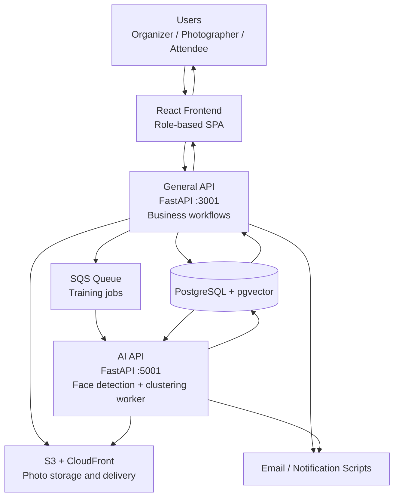

# AI Vision Architecture: System Architecture

This document describes the current architecture of the `ai-vision-architecture` repository as it exists in code on March 13, 2026.

It covers:

- the actual runtime topology
- the codebase structure
- the data model
- the main business and ML flows
- the operational dependencies
- the main architectural risks and drift points visible in the repository

This is an as-built architecture document, not a greenfield proposal. Where the current implementation diverges from the intended platform behavior, that is called out explicitly.

## Easy Architecture Diagram



### How to read it

1. Users interact only with the React frontend.
2. The frontend mostly talks to the `General API`.
3. The `General API` handles login, events, uploads, attendee access, and training requests.
4. Photo files are stored in `S3`, while metadata, embeddings, clusters, and job state live in `PostgreSQL + pgvector`.
5. When training starts, the `General API` sends a job to `SQS`.
6. The `AI API` picks that job from `SQS`, processes faces and clusters, then writes results back to the database.
7. Both backend services can trigger email notifications.

## 1. System Intent

The platform is a privacy-first event photo distribution system with four main user groups:

- organizers
- photographers
- attendees
- admins or platform operators

The intended product flow is:

1. An organizer creates an event.
2. Photographers upload event photo folders.
3. Attendees register with a selfie and identity details.
4. The system runs face detection and clustering across event photos.
5. The system maps attendee embeddings to discovered clusters.
6. Attendees can view and download only the photos linked to their cluster.

The repository implements this through a React frontend, two FastAPI services, PostgreSQL with `pgvector`, S3 and CloudFront for image storage and delivery, and AWS SQS for asynchronous AI job orchestration.

## 2. High-Level Topology

### 2.1 Logical View

```text
Browser / React SPA
    |
    +--> General API (FastAPI, port 3001)
    |       - auth
    |       - event lifecycle
    |       - uploads
    |       - attendee registration and attendee photo access
    |       - training orchestration
    |       - ZIP generation
    |       - email trigger scripts
    |
    +--> AI API (FastAPI, port 5001)
            - SQS worker
            - model loading
            - face detection
            - clustering
            - cluster-to-attendee matching
            - recognition endpoint
            - post-processing notifications

General API <-------> PostgreSQL + pgvector <-------> AI API
General API <-------> S3 / CloudFront
AI API      <-------> S3 / CloudFront
General API -------> AWS API Gateway / Lambda trigger
General API -------> AWS SQS queue
AI API      <------- AWS SQS queue (worker poller)
Both APIs   -------> Node.js email scripts
```

### 2.2 Docker Runtime View

The repository ships a `docker-compose.yml` with three services:

- `db`
  - PostgreSQL 17 with `pgvector`
- `general-api`
  - FastAPI app on port `3001`
- `ai-api`
  - FastAPI app on port `5001`

Shared volumes:

- `uploads`
- `downloads`
- `banners`

This indicates a hybrid storage design:

- local shared volumes exist for compatibility and static mounts
- the active upload pipeline in current backend code writes photo assets to S3 and stores S3 keys in the database

## 3. Repository Structure

### 3.1 Major Directories

```text
ai-vision-architecture/
  backend/
    general_api/
    ai_api/
    commons/
    services/
  frontend/
  db/
  docs/
  backend_backup/
```

### 3.2 Directory Responsibilities

- `frontend/`
  - React SPA
  - route composition
  - dashboard views
  - upload and cluster browsing UI
  - attendee experience
  - premium media features such as collage, cinematic, and flipbook creation

- `backend/general_api/`
  - business API
  - event management
  - organizer and photographer features
  - attendee registration and access flows
  - upload history and ZIP downloads
  - training request orchestration through AWS

- `backend/ai_api/`
  - heavy AI processing
  - SQS worker
  - model bootstrap
  - face extraction
  - embedding generation
  - clustering
  - attendee-to-cluster assignment

- `backend/commons/`
  - duplicate shared schema and service files
  - appears intended as a shared layer, but is not the single source of truth in practice

- `db/`
  - database bootstrap and patch scripts
  - contains legacy scripts that do not match the PostgreSQL schema used by the running backend

- `backend_backup/`
  - previous or fallback backend copies
  - useful as historical reference, but not part of the active runtime

## 4. Frontend Architecture

### 4.1 Composition Model

The SPA is route-driven through `frontend/src/App.jsx`.

Primary UI areas:

- landing and demo pages
- organizer login, registration, event list, and dashboard
- photographer login, registration, dashboard, and per-event upload page
- attendee registration, login, welcome, upload, and dashboard
- clustering overview and per-cluster viewer

### 4.2 Frontend State Strategy

The frontend is mostly client-state driven with:

- `useState`
- `useEffect`
- local storage for user session and registration state
- polling for long-running jobs

The main persisted browser keys in active flows include:

- `organizer_user`
- `photographer_user`
- `requireConsent_<eventId>`
- attendee registration draft state

There is no token-based auth session model in the frontend. Session identity is inferred from local storage content and URL parameters.

### 4.3 Frontend API Layer

There are two API layers:

- `frontend/src/services/api.js`
  - the more current service layer
  - groups APIs by domain: event, attendee, photo, training, cluster, organizer, photographer, auth, system
  - points to production base URLs directly

- `frontend/src/utils/photoClusteringApi.js`
  - older compatibility layer
  - still used by cluster and attendee views
  - contains several route and contract mismatches relative to current backend

This means the frontend is not using a single stable service abstraction. The architecture is partially converged, but not fully normalized.

### 4.4 Frontend Domain Surfaces

- Organizer dashboard
  - event metrics
  - upload tools
  - QR sharing
  - staff management
  - training trigger
  - event ZIP downloads

- Photographer event page
  - folder upload
  - upload history
  - folder photo viewing
  - folder deletion

- Attendee registration
  - OTP verification
  - selfie capture
  - biometric registration

- Attendee dashboard
  - matched photo browsing
  - ZIP download
  - collage, flipbook, cinematic outputs

- Cluster views
  - cluster grid for an event
  - per-cluster face listing
  - cluster rename attempt

### 4.5 Frontend Runtime Coupling

The frontend is tightly coupled to backend response shapes:

- snake_case response fields are often mapped manually
- route assumptions are embedded in UI components
- event and cluster identifiers are passed through URLs without signed authorization

This makes the frontend easy to move quickly, but brittle when backend contracts change.

## 5. Backend Architecture

## 5.1 General API Responsibilities

The `general_api` service is the primary business façade.

Key routers:

- `auth.py`
  - organizer and photographer registration
  - organizer login
  - attendee OTP send and verify
  - attendee lookup by email
  - invitation send trigger

- `events.py`
  - list events
  - create event
  - fetch event detail
  - update status
  - delete event
  - upload history
  - event ZIP download

- `photos.py`
  - folder upload
  - folder listing
  - folder photo listing
  - folder deletion

- `attendees.py`
  - attendee face registration
  - attendee detail
  - attendee matched photos
  - attendee photo ZIP download
  - attendee uploads

- `clustering.py`
  - metrics
  - active training jobs
  - trigger training
  - list clusters
  - list faces in cluster
  - cluster ZIP download
  - cluster rename

- `organizer.py`
  - organizer events
  - photographer assignment and removal

- `photographer.py`
  - photographer assigned events

The `general_api` service is therefore not just a lightweight CRUD layer. It is the orchestration and integration hub for the platform.

## 5.2 AI API Responsibilities

The `ai_api` service owns compute-heavy processing and background execution.

Key responsibilities:

- loading face detection and embedding models
- receiving SQS work items
- processing event photo sets
- generating embeddings
- clustering identities
- writing clusters and faces back to PostgreSQL
- matching attendee embeddings to cluster centroids
- sending completion notifications

It also exposes direct processing endpoints:

- `/processing/start`
- `/processing/register-face`
- `/processing/recognize`

In practice, the current frontend uses `general_api` for most attendee registration and training initiation, while `ai_api` is primarily the background worker.

## 5.3 Shared Infrastructure Code

Both APIs contain nearly identical copies of:

- `config.py`
- `database.py`
- `face_service.py`
- `notification_service.py`
- `model_manager.py`
- `schema.sql`

This is a major architecture characteristic:

- the system is split into multiple runtime services
- but not backed by a single shared package or well-defined common library

The result is copy-based reuse rather than versioned shared modules.

## 6. Data Architecture

The active schema is PostgreSQL-oriented and defined in `backend/commons/schema.sql`, with duplicated copies under both API packages.

### 6.1 Core Tables

- `roles`
  - role catalog

- `users`
  - platform users such as organizers and photographers

- `user_roles`
  - user-to-role mapping

- `events`
  - event metadata, banner, QR code path, owner email, status

- `user_events`
  - organizer and photographer relationship to events

- `event_photographers`
  - explicit photographer assignment

- `photos`
  - uploaded photo records
  - event ownership
  - uploader reference
  - optional attendee ownership
  - physical asset path or S3 key

- `upload_jobs`
  - upload batches, progress, status, source actor

- `attendees`
  - attendee identity and face embedding
  - optional matched `cluster_id`

- `people_clusters`
  - discovered identity group per event
  - centroid embedding
  - thumbnail photo reference

- `faces`
  - detected face instance in a photo
  - cluster association
  - per-face embedding
  - bounding box
  - detection quality and confidence

- `training_jobs`
  - AI pipeline execution state for an event

### 6.2 Relationship Model

```text
users ----< user_roles >---- roles
users ----< user_events >---- events
users ----< event_photographers >---- events

events ----< photos
events ----< attendees
events ----< people_clusters
events ----< upload_jobs
events ----< training_jobs

photos ----< faces
people_clusters ----< faces
attendees ---- photos (optional attendee uploads)
attendees ---- people_clusters (matched cluster_id)
```

### 6.3 Vector Storage

The system uses `pgvector` for:

- attendee face embeddings
- face embeddings
- cluster centroids

HNSW indexes exist for:

- attendee embeddings
- face embeddings
- cluster centroids

This is the correct architectural direction for identity search and approximate nearest-neighbor operations in PostgreSQL.

## 7. Storage Architecture

### 7.1 Photo Storage

The active upload code stores images in S3 and writes S3 keys into `photos.file_path`.

Examples:

- `uploads/<event_id>/<folder_name>/<uuid>.jpg`
- `uploads/<event_id>/<uuid>.jpg`

Delivery is expected through:

- raw S3 URL
- CloudFront URL

### 7.2 Local Storage Compatibility

The APIs also:

- mount local `/uploads`
- mount local `/downloads`
- generate ZIP files on local disk
- mount `/uploads` as static content in FastAPI

This means the system is not purely S3-native. It operates in a hybrid mode:

- source image records can be S3-backed
- ZIP generation and legacy local paths still depend on local filesystem assumptions

### 7.3 Download Strategy

ZIP download endpoints currently generate archives server-side into `downloads/` and then return them as `FileResponse`.

This pattern exists for:

- whole event downloads
- cluster downloads
- attendee-selected downloads

That is simple to implement, but expensive for large datasets and not yet offloaded to object storage or a background export pipeline.

## 8. ML / Face Processing Architecture

### 8.1 Model Loading

`face_service.py` uses a fallback stack:

1. InsightFace `FaceAnalysis`
2. FaceNet via `facenet-pytorch`

Selection behavior:

- prefer InsightFace
- use GPU if CUDA is available
- fall back to CPU or FaceNet when necessary

### 8.2 Detection Pipeline

For each photo in an event:

1. load image from S3 or local disk
2. detect all faces
3. generate embeddings
4. compute quality score
5. accumulate face records in memory

Training progress is updated incrementally in `training_jobs`.

### 8.3 Clustering Pipeline

The clustering strategy implemented in `ai_api/services/training_service.py` is:

1. normalize embeddings
2. compute cosine similarity matrix
3. run Chinese Whispers clustering
4. merge oversplit clusters using centroid similarity
5. compute centroids
6. persist clusters
7. persist or update faces with cluster assignments

### 8.4 Attendee Matching

Attendee-to-cluster association is done by comparing attendee embeddings to cluster centroids.

Current behavior includes two matching passes:

- `match_attendees_to_clusters`
  - normalized embedding comparison using Euclidean distance to centroids

- notification phase inside `process_training_job`
  - normalized cosine similarity against centroids
  - updates `attendees.cluster_id` again if the threshold is met

Architecturally, this means matching logic exists twice in the same service, using different thresholds and distance styles.

### 8.5 Thumbnail Strategy

For each cluster:

- the highest-quality detected face is used indirectly through its `photo_id`
- cluster rows store `thumbnail_photo_id`
- cluster APIs then fetch face box coordinates for that photo

This is a sound basic approach for representing an identity cluster without storing cropped images separately.

## 9. Event and User Flows

## 9.1 Organizer Registration and Login

Flow:

1. Organizer registers through `POST /auth/register`
2. Password is hashed
3. User row is created
4. Frontend stores the returned user context in local storage after login

Important current behavior:

- the registration flow does not populate `user_roles`
- login uses a join to `user_roles` but then falls back to permissive organizer behavior if no role exists

This means role enforcement is heuristic, not strict.

## 9.2 Event Creation Flow

Flow:

1. Organizer submits event form.
2. `general_api` creates event record.
3. Event-photographer links are inserted.
4. User-event links are inserted.
5. QR code is generated and saved under `/uploads/qrcodes`.
6. Banner is selected from static banner folders.
7. Photographer invitation notifications are queued.
8. Event creation confirmation is queued.

Data created:

- `events`
- `user_events`
- `event_photographers`
- QR image in filesystem

## 9.3 Photographer Upload Flow

Flow:

1. Photographer selects files or folder in frontend.
2. Frontend sends multipart upload to `POST /photos/upload-folder`.
3. `upload_jobs` row is created.
4. Each file is streamed to S3.
5. Photo metadata is batch-inserted into `photos`.
6. Upload job progress is updated.
7. Organizer notification is sent on completion.

Architecturally, uploads are folder-oriented in UI intent, but the API accepts a flat list of files plus a folder name.

## 9.4 Attendee Registration Flow

Flow:

1. Attendee lands on registration page from QR or direct URL.
2. OTP is sent and verified through `general_api`.
3. Attendee captures selfie.
4. Frontend submits form and selfie blob.
5. Backend loads face models and computes embedding.
6. Attendee row is inserted with `face_embedding`.
7. Registration email is triggered.

This is synchronous from the attendee perspective. Registration depends on model availability at request time.

## 9.5 Training Orchestration Flow

Flow:

1. Organizer clicks start processing.
2. Frontend calls `POST /clustering/start` on `general_api`.
3. `general_api` tries to wake AI infrastructure through API Gateway.
4. `general_api` inserts a `training_jobs` row with `queued`.
5. `general_api` publishes a message to SQS.
6. `ai_api` SQS worker long-polls queue.
7. Worker receives job and runs `process_training_job`.
8. Results are written back to PostgreSQL.
9. Event status becomes `completed`.
10. Organizer and attendee notifications are sent.

This is the central asynchronous architecture of the platform.

## 9.6 Attendee Photo Access Flow

Flow:

1. Attendee logs in or is routed directly via attendee ID.
2. Frontend fetches attendee detail.
3. Frontend fetches attendee photo list.
4. Backend looks up `attendees.cluster_id`.
5. Backend returns all `faces` whose `person_cluster_id` matches that cluster.
6. Frontend builds photo URLs and renders images.

This is how privacy boundaries are intended to work: attendee access is reduced to the cluster assigned to that attendee.

## 9.7 ZIP Download Flows

There are three distinct ZIP paths:

- event ZIP
- cluster ZIP
- attendee-selected photo ZIP

All are generated server-side in process and written to local disk before being served.

## 10. Background and Integration Architecture

### 10.1 AWS Dependencies

The active runtime assumes these AWS integrations:

- S3
  - photo storage

- CloudFront
  - photo delivery

- SQS
  - training job queue

- API Gateway plus Lambda
  - wake or trigger compute before queue processing

The architecture assumes external AI infrastructure may not always be warm, so `general_api` attempts to trigger a warm-up or startup action before queuing work.

### 10.2 Notification Layer

Email sending is delegated to Node scripts launched via Python `subprocess`.

This is true in both APIs.

Notification types include:

- photographer invitation
- organizer upload completion
- guest invitation
- OTP email
- organizer processing completion
- attendee processing completion
- event creation confirmation
- attendee registration email

Architecturally, this is a polyglot service boundary embedded inside each API container:

- Python handles orchestration
- Node handles mail formatting and transport

## 11. Status and State Model

### 11.1 Event Statuses Seen in Code

Observed statuses:

- `active`
- `processing`
- `completed`
- `closed`
- `archived` is mentioned in comments but not enforced as a state machine

There is no centralized state transition model. Status transitions happen from multiple places:

- organizer dashboard
- event status endpoint
- training service

### 11.2 Upload Job Statuses

Observed statuses:

- `pending`
- `in_progress`
- `uploading`
- `completed`
- `completed_with_errors`

### 11.3 Training Job Statuses

Observed statuses:

- `queued`
- `processing`
- `in_progress`
- `completed`
- `failed`

Status semantics are used by frontend polling logic, but not formalized as a shared contract object or enum package.

## 12. Current Architectural Strengths

- Clear separation between business workflow and compute-heavy ML processing.
- Good use of PostgreSQL plus `pgvector` for identity search and centroid matching.
- The data model is aligned with the core domain: events, uploads, attendees, clusters, faces, jobs.
- Training is decoupled from the web request path through SQS.
- The frontend has strong role-oriented screens and user journeys.
- S3 and CloudFront are the right direction for large media delivery.
- Cluster thumbnails, bounding boxes, and quality scoring are already represented in the model.

## 13. Current Architectural Gaps and Risks

These are the most important issues visible from the repository.

### 13.1 Authentication and authorization are weak

- No JWT or server-side session layer exists.
- Identity is largely passed through local storage, form fields, and URL params.
- Sensitive endpoints trust raw `admin_id`, `photographer_id`, `attendee_id`, or `user_id`.
- Privacy enforcement depends heavily on client behavior and database lookups, not authenticated claims.

### 13.2 OTP architecture is not production-safe

- OTPs are stored in an in-memory dictionary.
- This breaks across multiple instances or restarts.
- There is no rate limit, TTL persistence layer, or distributed store.

### 13.3 Password handling is below production standard

- Passwords are hashed with plain SHA-256.
- There is no salt or password-hardening algorithm such as Argon2 or bcrypt.

### 13.4 Upload lock is not enforced at the backend

The product intent says uploads must stop when training starts, but:

- organizer and photographer UIs express this concept
- backend upload endpoints do not currently enforce event status before accepting uploads

This is a business-rule gap, not just a UI issue.

### 13.5 Shared code is duplicated instead of centralized

- config, database, face, notification, model, and schema code are copied across packages
- this increases drift risk
- fixes can land in one API and not the other

### 13.6 API contract drift already exists

Examples visible in code:

- some frontend code calls routes that do not exist in the active backend
- cluster rename request shape does not match backend expectation
- local Vite proxy config exists, but the main service layer hardcodes production URLs

This indicates architecture drift between frontend and backend evolution.

### 13.7 Database source of truth is fragmented

- active runtime uses PostgreSQL schema files under `backend/*/schema.sql`
- `db/` contains legacy SQL that appears MySQL-oriented
- some backend code depends on columns not present in the canonical PostgreSQL schema file

This creates migration ambiguity.

### 13.8 Storage assumptions are mixed

- S3 is the active upload target
- local static mounts and local ZIP generation remain in place
- some download logic still assumes local file paths

The system is therefore neither fully local-first nor fully object-storage-native.

### 13.9 Import and module hygiene is inconsistent

Some modules import through:

- package-qualified imports
- direct local imports via manual `sys.path` mutation
- partially duplicated helper imports inside functions

This is a maintainability and runtime consistency issue.

### 13.10 Email script dependencies are partially missing in the active tree

The Python notification layer references scripts for OTP and invitations that are not present in the active backend package tree, which strongly suggests partial runtime breakage or leftover path drift.

### 13.11 Face matching logic is duplicated

Cluster-to-attendee matching exists in more than one place and uses different thresholds and similarity approaches, which can produce inconsistent outcomes.

## 14. Recommended Target Architecture

This is the architecture I would recommend evolving toward, based on the current codebase.

### 14.1 Keep the split between business API and AI worker

The current split is correct in principle:

- `general_api` should remain the user-facing business service
- `ai_api` should become a pure worker and AI-processing service

The boundary should become stricter:

- all browser traffic should go only through the business API or API gateway
- AI API should mostly consume queue work and expose only internal admin endpoints

### 14.2 Introduce a real shared backend package

Create a single shared package for:

- settings
- database access
- domain enums
- DTOs
- vector helpers
- notification abstraction
- storage abstraction

This removes copy drift between `general_api` and `ai_api`.

### 14.3 Formalize storage through an abstraction

Create a single photo storage adapter with implementations for:

- S3
- local disk

All upload, read, delete, and ZIP export logic should go through that adapter instead of mixing direct path handling and bucket handling in routers.

### 14.4 Replace browser-local identity with real auth

Use:

- JWT access tokens
- refresh tokens or session cookies
- server-side role checks
- event-scoped authorization checks

This is mandatory for attendee privacy guarantees.

### 14.5 Move long-running exports to async jobs

ZIP generation should become:

1. request export
2. queue export job
3. generate archive in worker
4. store archive in object storage
5. return signed download URL

That avoids web-worker blocking and local disk buildup.

### 14.6 Normalize state machines

Define shared enums for:

- event status
- upload job status
- training job status

Then enforce transitions in the backend, not just in the frontend.

### 14.7 Make the frontend use one API client only

Retire legacy utility layers and converge on one typed service module. That will reduce route drift and simplify environment switching.

### 14.8 Separate notification orchestration from mail transport

Instead of direct `subprocess` calls from request handlers and workers:

- emit notification jobs
- process them through a dedicated notification worker or provider client

That will make retries and failures visible and controllable.

## 15. Reference Architecture Summary

In current form, this project is best described as:

- a modular monorepo
- with a split-service backend
- using PostgreSQL plus `pgvector` as the central state and similarity store
- using S3 plus CloudFront for media
- using SQS to decouple long-running AI jobs
- with a React SPA acting as a role-based operational console

Its strongest core is the event-photo-to-cluster-to-attendee data pipeline.

Its weakest core is security and contract consistency:

- auth is too soft
- state rules are not enforced centrally
- the codebase has drift between frontend and backend API assumptions
- shared backend logic is duplicated rather than unified

## 16. Immediate Priority Fixes

If this system is being prepared for production hardening, these should be first:

1. Introduce real authentication and role-based authorization.
2. Enforce no-upload rules in backend upload endpoints.
3. Replace SHA-256 password hashing with Argon2 or bcrypt.
4. Move OTP storage to Redis or database with TTL and rate limits.
5. Consolidate backend shared modules into one package.
6. Remove or repair legacy frontend API utilities and align all route contracts.
7. Establish one PostgreSQL migration source of truth.
8. Move ZIP creation and notification dispatch into explicit background jobs.

## 17. Analysis Scope Notes

This document was created from repository inspection only.

What was inspected directly:

- Docker composition
- frontend routes and service layers
- backend entrypoints, routers, services, and schema
- current docs and database patch files

What was not verified by execution in this pass:

- live API behavior
- actual AWS resources
- image and model runtime behavior
- production environment variables
- end-to-end browser flows


